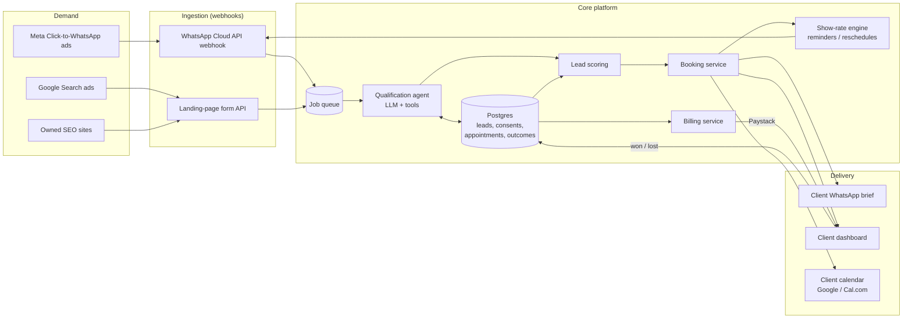

# 03 — Technical Architecture

> Principle: **boring infrastructure, sharp AI.** Use managed services everywhere except where the product's edge comes from: the qualification agent, the show-rate engine and the outcome loop.

## 1. System overview



## 2. Stack

| Layer | Choice | Why |
|---|---|---|
| Language | **TypeScript** end to end | One language for web, API and workers. Big hiring pool. |
| Web + API | **Next.js** on **Vercel** | Landing pages, client dashboard and API routes in one deployable unit |
| Database + auth | **Supabase** (Postgres, Row Level Security, Auth) | Managed Postgres. RLS gives multi-tenant isolation per client for free. Schema in [`db/schema.sql`](../db/schema.sql). |
| Queue / workers | Supabase `pg_cron` + a job table at first; **Inngest** or **Trigger.dev** at scale | Webhooks must return in under a second. All AI work runs asynchronously, with retries. |
| Messaging | **WhatsApp Business Cloud API** (Meta) as primary; **Twilio** SMS as fallback | WhatsApp dominates in SA. SMS covers numbers that aren't on WhatsApp. |
| LLM | **Claude API**, tiered: a small, fast model for classification and extraction; a larger model for the open conversation | Cost control: most turns are cheap extraction, and only the hard turns use the big model |
| Calendar | Google Calendar API / **Cal.com** | Clients keep the calendar they already use |
| Payments | **Paystack** (SA cards, EFT, recurring) | Local acquiring and supports prepaid top-ups |
| Analytics | Postgres views → **Metabase** | The funnel view is SQL. No separate analytics tool needed until about 50k leads/month. |
| Observability | Sentry (errors) + structured logs + LLM trace table (`messages.model`, tokens, cost) | Every rand spent on AI is attributable to a lead |

## 3. Critical flows

### 3.1 Inbound WhatsApp lead (latency budget: first reply < 10 s)

1. The webhook receives a message. It verifies the signature, stores the message idempotently (`messages.provider_id` is unique), enqueues a job, and returns `200` within 1 second.
2. The worker loads the lead and checks `current_consent`.
3. **First turn:** the agent introduces itself as an *automated assistant* for `<brand>`, and states the purpose and the opt-out ("reply STOP"). The consent row is written with the exact wording.
4. Qualification loop: the agent asks one question per turn and extracts structured fields into `leads.qualification` (JSON validated against a schema).
5. Scoring: rules plus a model. Score ≥ threshold → booking. Below → polite close, plus an optional nurture sequence (with marketing consent only).
6. Booking: the agent offers 3 slots taken from the client's live availability. The lead picks one, an `appointments` row is created, and the client is notified.

### 3.2 Show-rate engine

| Time | Action |
|---|---|
| T+0 | Confirmation with installer name, photo and address. Calendar invite (.ics). |
| T−24h | Reminder plus "reply 1 to confirm, 2 to reschedule" |
| T−2h | Reminder plus an "installer on the way" message |
| T+1h after slot | Ask the lead "Did <installer> arrive?" The answer is evidence of attendance for billing. |
| No-show | Automatic offer to reschedule. The appointment isn't billed. |

### 3.3 Outcome loop

The client dashboard and WhatsApp send a one-tap **Won / Lost / Pending** request at day 3, 7 and 14. Outcomes write to `outcomes`, which feeds the weekly scoring retrain and per-campaign ROAS. Missing outcomes after 14 days pause new bookings for that client. That is a contract term.

## 4. Lead scoring roadmap

| Phase | Method | Data needed |
|---|---|---|
| v0 (launch) | Hand-written rules: homeowner + in territory + bill > R2k + timeline < 3 months | None |
| v1 (~300 outcomes) | Logistic regression on qualification fields + source + time to reply | `outcomes` labels |
| v2 (~2,000 outcomes) | Gradient boosting + LLM-derived intent features from the transcript | Transcripts + outcomes |
| v3 | Feed conversion values back to Meta and Google (Conversions API / offline conversions) so the *ad platforms* optimise for won deals, not leads | Outcome events with value |

**v3 is the main lever.** When the ad algorithms optimise toward closed revenue instead of cheap form fills, cost per *attended* appointment falls, and competitors can't copy that without our outcome data.

## 5. AI agent design and guardrails

- **Persona:** a named assistant that clearly says it's automated. It never claims to be human.
- **Tools the agent can call:** `get_availability`, `book_slot`, `save_answers`, `handoff_to_human`, `opt_out`. It cannot do anything outside these.
- **Hard rules in the system prompt plus output checks:** no prices or quotes, no savings guarantees, no financial advice, no claims about government rebates, and no collecting ID numbers or banking details.
- **Human handoff triggers:** anger, a complaint, a legal threat, a question outside scope, or 3 failed extractions in a row.
- **QA:** sample 5% of transcripts daily, plus 100% of handoffs. Use an LLM grader with a rubric, plus human review of anything it flags.
- **Prompt injection:** treat all user text as data. The agent's tools validate arguments server-side (e.g. it can only book slots that are actually free).
- **Cost guardrail:** maximum turns per lead and a maximum token budget per lead. A lead over budget goes to a human, not to an unbounded AI loop.

## 6. Security and data protection (engineering view)

| Control | Implementation |
|---|---|
| Tenant isolation | Supabase RLS: a client user can only `select` leads and appointments where `assigned_client = auth.uid()`'s client |
| Least privilege | The service role key lives only in workers, never in the browser |
| Secrets | Vercel or Supabase encrypted env vars. Rotated quarterly. |
| Webhook integrity | Verify the Meta `X-Hub-Signature-256` and Paystack signatures. Reject unsigned requests. |
| PII minimisation | No ID numbers, no banking details. Phone number plus area only where possible. |
| Retention | Disqualified leads: PII erased after 90 days. Won/lost: kept 24 months, then anonymised. Erasure sets `erased_at` and nulls the PII fields. |
| Region | Choose an EU or closest-available region for hosting. Document the POPIA §72 cross-border basis ([04-compliance.md](04-compliance.md)). |
| Backups | Supabase point-in-time recovery, with a monthly restore test |
| Audit | The consent ledger is append-only, and every outbound message is logged with its author (agent or human) |

## 7. Repository layout (target)

```
LEAD-GEN/
├── apps/
│   ├── web/            # Next.js: landing pages + client dashboard + API routes
│   └── worker/         # queue consumers: agent, reminders, billing
├── packages/
│   ├── agent/          # prompts, tool definitions, guardrails, evals
│   ├── scoring/        # rules v0 -> models v1+
│   └── db/             # typed client generated from schema
├── db/
│   └── schema.sql      # source of truth (exists)
├── tools/
│   └── unit_economics.py  # financial model (exists)
└── docs/               # this plan
```

## 8. Build order (engineering)

1. `db/schema.sql` applied, plus RLS policies ← **schema done and verified on Postgres 16**
2. WhatsApp webhook → stored message → echo reply (proves the pipe end to end)
3. Qualification agent with 5 hard-coded questions and structured extraction
4. Booking against one client's Google Calendar
5. Show-rate reminders (scheduled jobs)
6. Client dashboard: appointment list plus the Won/Lost button
7. Paystack prepaid top-ups and automatic invoices from attended appointments
8. Funnel dashboard (Metabase on `funnel_daily`)
9. Outcome-based scoring v1 and offline conversion upload to the ad platforms
