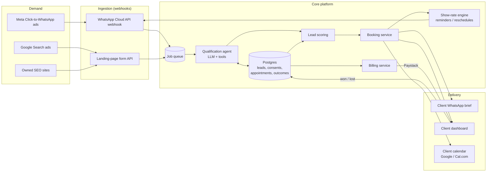
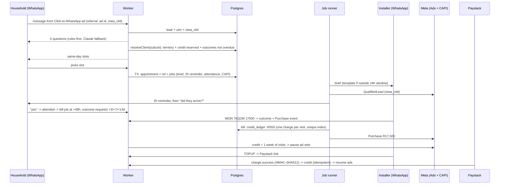

# 03 — Technical Architecture

> Principle: **boring infrastructure, sharp AI.** Use managed services everywhere except where the product's edge comes from: the qualification agent, the show-rate engine and the outcome loop.

## 1. System overview



## 2. Stack

| Layer | Choice | Why |
|---|---|---|
| Language | **TypeScript** end to end | One language for web, API and workers. Big hiring pool. |
| Web + API | **Next.js** on **Vercel** | Landing pages, client dashboard and API routes in one deployable unit |
| Database + auth | **Supabase** (Postgres, Row Level Security, Auth) | Managed Postgres. RLS gives multi-tenant isolation per client for free. Schema in [`db/migrations/`](../db/migrations). |
| Queue / workers | Supabase `pg_cron` + a job table at first; **Inngest** or **Trigger.dev** at scale | Webhooks must return in under a second. All AI work runs asynchronously, with retries. |
| Messaging | **WhatsApp Business Cloud API** (Meta) as primary; **Twilio** SMS as fallback | WhatsApp dominates in SA. SMS covers numbers that aren't on WhatsApp. |
| LLM | **Claude API**, tiered: a small, fast model for classification and extraction; a larger model for the open conversation | Cost control: most turns are cheap extraction, and only the hard turns use the big model |
| Calendar | Google Calendar API / **Cal.com** | Clients keep the calendar they already use |
| Payments | **Paystack** (SA cards, EFT, recurring) | Local acquiring and supports prepaid top-ups |
| Analytics | Postgres views → **Metabase** | The funnel view is SQL. No separate analytics tool needed until about 50k leads/month. |
| Observability | Sentry (errors) + structured logs + LLM trace table (`messages.model`, tokens, cost) | Every rand spent on AI is attributable to a lead |

## 3. Critical flows

### 3.1 Inbound WhatsApp lead (latency budget: first reply < 10 s)

1. The webhook receives a message. It verifies the signature, stores the message idempotently (`messages.provider_id` is unique), enqueues a job, and returns `200` within 1 second.
2. The worker loads the lead and checks `current_consent`.
3. **First turn:** the agent introduces itself as an *automated assistant* for `<brand>`, and states the purpose and the opt-out ("reply STOP"). The consent row is written with the exact wording.
4. Qualification loop: the agent asks one question per turn and extracts structured fields into `leads.qualification` (JSON validated against a schema).
5. Scoring: rules plus a model. Score ≥ threshold → booking. Below → polite close, plus an optional nurture sequence (with marketing consent only).
6. Booking: the agent offers 3 slots taken from the client's live availability. The lead picks one, an `appointments` row is created, and the client is notified.

### 3.2 Show-rate engine

| Time | Action |
|---|---|
| T+0 | Confirmation with installer name, photo and address. Calendar invite (.ics). |
| T−24h | Reminder plus "reply 1 to confirm, 2 to reschedule" |
| T−2h | Reminder plus an "installer on the way" message |
| T+1h after slot | Ask the lead "Did <installer> arrive?" The answer is evidence of attendance for billing. |
| No-show | Automatic offer to reschedule. The appointment isn't billed. |

### 3.3 Outcome loop

WhatsApp asks the installer for **WON / LOST** at day 3, 7 and 14 (there is no dashboard, because installers live in WhatsApp). Outcomes write to `outcomes`, which feeds `ad_performance`, the Conversions API and, later, scoring. An attended visit with no outcome after 14 days **removes that installer from routing** (enforced in SQL, not by reminders).

### 3.4 As built: the pilot pack (steps 1–6)



| Step | What | Code |
|---|---|---|
| 1 | Reminders + attendance check; 07:00–21:00 courtesy window with deferral; WhatsApp 24h window → template fallback | `db/jobs.ts`, `templates.ts`, `quietHours.ts` |
| 2 | Installer commands `WON/LOST/NOSHOW/BALANCE/TOPUP/HELP`; brief with booking ref; outcome requests; dispute state | `db/ops.ts` (`handleInstallerMessage`) |
| 3 | Referral parsing → `leads.utm` + `ctwa_clid`; `ad_spend_daily` + `ad_performance` view | `whatsapp.ts`, migration 0004 |
| 4 | Claude fallback: constrained JSON per question type, re-validated by the rule parser, usage logged per message | `llm.ts` |
| 5 | Credit ledger, reservation-aware routing, billing after 48h, auto pause/resume of ad sets, Paystack link + webhook | `db/ops.ts`, `paystack.ts`, `meta.ts` |
| 6 | Conversions API for Business Messaging: QualifiedLead on booking, Purchase + value on WON, dedup `event_id` | `meta.ts`, `db/jobs.ts` |

**LLM fallback design.** The model never writes to the household and never chooses the next step. It sees only the question and the one reply (no name or phone), returns JSON constrained by a schema (an enum of the allowed options), and the result is fed back through the same rule parser. A bad or refused answer degrades to the normal re-prompt. Model: `claude-opus-5-5` at `effort: low` with server-side refusal fallback; override with `LLM_MODEL`.

## 4. Lead scoring roadmap

| Phase | Method | Data needed |
|---|---|---|
| v0 (launch) | Hand-written rules: homeowner + in territory + bill > R2k + timeline < 3 months | None |
| v1 (~300 outcomes) | Logistic regression on qualification fields + source + time to reply | `outcomes` labels |
| v2 (~2,000 outcomes) | Gradient boosting + LLM-derived intent features from the transcript | Transcripts + outcomes |
| v3 | Feed conversion values back to Meta and Google (Conversions API / offline conversions) so the *ad platforms* optimise for won deals, not leads | Outcome events with value |

**v3 is the main lever.** When the ad algorithms optimise toward closed revenue instead of cheap form fills, cost per *attended* appointment falls, and competitors can't copy that without our outcome data.

## 5. AI agent design and guardrails

- **Persona:** a named assistant that clearly says it's automated. It never claims to be human.
- **Tools the agent can call:** `get_availability`, `book_slot`, `save_answers`, `handoff_to_human`, `opt_out`. It cannot do anything outside these.
- **Hard rules in the system prompt plus output checks:** no prices or quotes, no savings guarantees, no financial advice, no claims about government rebates, and no collecting ID numbers or banking details.
- **Human handoff triggers:** anger, a complaint, a legal threat, a question outside scope, or 3 failed extractions in a row.
- **QA:** sample 5% of transcripts daily, plus 100% of handoffs. Use an LLM grader with a rubric, plus human review of anything it flags.
- **Prompt injection:** treat all user text as data. The agent's tools validate arguments server-side (e.g. it can only book slots that are actually free).
- **Cost guardrail:** maximum turns per lead and a maximum token budget per lead. A lead over budget goes to a human, not to an unbounded AI loop.

## 6. Security and data protection (engineering view)

| Control | Implementation |
|---|---|
| Tenant isolation | Supabase RLS: a client user can only `select` leads and appointments where `assigned_client = auth.uid()`'s client |
| Least privilege | The service role key lives only in workers, never in the browser |
| Secrets | Vercel or Supabase encrypted env vars. Rotated quarterly. |
| Webhook integrity | Verify the Meta `X-Hub-Signature-256` and Paystack signatures. Reject unsigned requests. |
| PII minimisation | No ID numbers, no banking details. Phone number plus area only where possible. |
| Retention | Disqualified leads: PII erased after 90 days. Won/lost: kept 24 months, then anonymised. Erasure sets `erased_at` and nulls the PII fields. |
| Region | Choose an EU or closest-available region for hosting. Document the POPIA §72 cross-border basis ([04-compliance.md](04-compliance.md)). |
| Backups | Supabase point-in-time recovery, with a monthly restore test |
| Audit | The consent ledger is append-only, and every outbound message is logged with its author (agent or human) |

## 7. Repository layout (target)

```
LEAD-GEN/
├── apps/
│   ├── web/            # Next.js: landing pages + client dashboard + API routes
│   └── worker/         # WhatsApp webhook, playbook agent, Postgres store, jobs, billing, Meta, Paystack (exists)
├── packages/
│   ├── agent/          # prompts, tool definitions, guardrails, evals
│   ├── scoring/        # rules v0 -> models v1+
│   └── db/             # typed client generated from schema
├── db/
│   └── migrations/     # 0001 init · 0002 worker state · 0003 handoff queue · 0004 pilot pack (exists)
├── tools/
│   └── unit_economics.py  # financial model (exists)
└── docs/               # this plan
```

## 8. Build order (engineering)

| # | Step | Status |
|---|---|---|
| 1 | Schema migrations + tracked runner | ✅ `db/migrations/0001–0004`, `npm run db:migrate` |
| 2 | WhatsApp webhook → stored message → reply | ✅ signature check, idempotency, per-sender serial queue |
| 3 | Qualification agent | ✅ playbook-driven (`playbooks/water.ts` default, `solar.ts`) |
| 4 | Booking against installer availability | ✅ slot rules per playbook, holidays, territory routing · ⏳ calendar adapter (`slotsFor`) |
| 5 | Show-rate engine | ✅ pilot step 1 |
| 6 | Installer interface | ✅ on WhatsApp (pilot step 2). A dashboard is deliberately skipped. |
| 7 | Billing | ✅ prepaid ledger + Paystack (pilot step 5) |
| 8 | Funnel + ad dashboards | ✅ SQL views (`funnel_daily`, `ad_performance`, `handoff_queue`, `client_balance`) · ⏳ Metabase |
| 9 | Outcome feedback to ad platforms | ✅ Meta Conversions API (pilot step 6) · ⏳ Google offline conversions |
| 10 | Postgres store | ✅ transactional, restart-safe, POPIA erasure |
| 11 | LLM fallback | ✅ pilot step 4 |
| 12 | RLS policies (if installers ever get DB-backed UI access) | ⏳ |

### Design notes

- **The agent is a pure function** `(state, text, ctx) → (state, replies, events)`. Everything vertical-specific lives in a playbook, so a new niche is one file.
- **Persist, then send.** State is committed before any reply goes out; the bot never confirms a booking that wasn't recorded (tested).
- **Transactional outbox.** An appointment and all of its jobs are inserted in one transaction, so a booking can't exist without its brief and reminders.
- **Route before offering slots.** The worker resolves the installer (territory + credit + outcome compliance) before the agent offers times. A qualified lead with no available installer goes to a human, never to dead slots.
- **Job runner** uses `FOR UPDATE SKIP LOCKED` (safe with several instances), exponential backoff, 5 attempts, and every job re-checks state at run time (cancelled visits skip their reminders).
- **Money is append-only.** `credit_ledger` + `client_balance`; one charge per visit (unique index); Paystack credits are idempotent on the reference.
- **Two runtime dependencies:** `pg` and `@anthropic-ai/sdk`. Node ≥ 22.18 runs TypeScript natively.
- **CI** runs all tests on Postgres 16, checks the docs against the financial model, and checks every doc link.

### Known limits (accepted for the pilot, fix before scale)

| Limit | Impact | Fix |
|---|---|---|
| Per-sender ordering is in-process only | Several worker instances could interleave one lead's messages | Row lock on the lead, or a queue keyed by phone |
| Job runner sets `pending` with a JSON patch while an inbound message may be mid-flight | A reminder's "reply 1/2" context could be overwritten in a rare race | Same row lock |
| A crash between ack and save loses that one inbound message | The household repeats one answer | Write raw webhooks to an inbox table before acking |
| Installer chat is not stored (only commands are processed) | No audit trail of installer messages | `client_messages` table |
| Slots come from playbook rules, not live calendars | An installer could be double-booked across channels | Calendar adapter behind `slotsFor` |
| Graph API version and CAPI event names are configurable defaults | Meta changes versions often | Verify in Events Manager at go-live (`META_API_VERSION`) |
